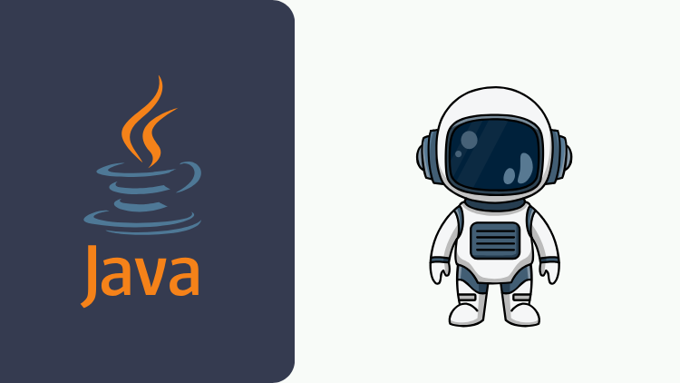

# Modern Java Development with AI Agents, Subagents & Claude

This repository contains the source code for my Udemy course on modern Java development using **AI Agents, Subagents, Claude Code, and AI-driven engineering workflows**.

⚡ Production-focused hands-on course for applying AI to real software engineering workflows, not just code generation.

---

## What you will learn

* Apply AI-driven software engineering workflows
* Use Claude Code for real-world Java development
* Master Context Engineering with `CLAUDE.md` and Rules
* Create reusable Agent Skills
* Build task analysis and implementation workflows
* Integrate Claude Code with GitHub
* Use AI Agents and Subagents for parallel development
* Build Java and Spring Boot microservices with AI
* Connect Claude Code to external systems using MCP
* Apply AI to planning, coding, testing, pull requests, and code reviews

---

## What you will build

* A distributed **Java/Spring Boot microservice application**
* Movie, User, and Recommendation microservices
* AI-driven software engineering workflows
* Reusable Skills for software development tasks
* Subagent-based parallel development workflows
* GitHub-integrated development workflows
* MCP-powered AI development workflows
